# SportsShed – Sports Equipment Issue Management System

**Backend Development Fundamentals (BDF) Group Assignment**  
**Group:** 5  
**Academic Year:** 2026–2027  
**Repository:** [Dheeraj-std/SportsShed](https://github.com/Dheeraj-std/SportsShed)

SportsShed is a backend application for managing players, sports kits, and equipment loans. It provides REST APIs to maintain player and kit records, issue equipment, retrieve loan information, search records, validate input, and process equipment returns. The backend is built with Node.js and Express.js and uses SQLite for data storage.

> **Documentation scope:** This README combines the project overview and the five members' individual contribution reports. Individual contribution details are based on the information supplied by the respective members. Screenshots included here are the evidence files provided with the project documentation. Where member-specific screenshots were not supplied, this README states that clearly instead of inventing evidence.

---

## 1. Project Objectives

- Store and manage player information.
- Store and manage sports kit information and quantities.
- Create and retrieve equipment loan records.
- Display loan records with related player and kit information.
- Validate player, kit, and loan input.
- Search player records by name or email.
- Search kit records by kit name or sport.
- Check equipment availability and prevent double booking.
- Record equipment returns and update available stock.
- Test API behavior using Postman.

## 2. Technology Stack

| Technology | Purpose |
|---|---|
| Node.js | JavaScript runtime for the backend |
| Express.js | HTTP server and REST API routing |
| SQLite3 | Relational database |
| JavaScript | Backend implementation |
| Postman | API request and response testing |
| Git and GitHub | Version control and team collaboration |

## 3. Project Structure

The project is organized into separate folders for database configuration, middleware, route handlers, and business logic.

```text
SportsShed/
├── database/
│   ├── db.js
│   ├── schema.sql
│   └── test-loan-rules.js
├── middleware/
│   └── validation.js
├── routes/
│   ├── players.js
│   ├── kits.js
│   └── loans.js
├── services/
│   └── loanRules.js
├── app.js
├── package.json
├── package-lock.json
└── README.md
```

The exact project structure may differ slightly depending on the latest repository version. The SQLite database file may be generated locally when the application starts and may be excluded from version control.

## 4. Database Overview

SportsShed uses three main relational tables:

| Table | Purpose |
|---|---|
| `players` | Stores player details |
| `kits` | Stores sports kit details and quantity information |
| `loans` | Stores equipment issue and return records and links players with kits |

### Entity relationship overview

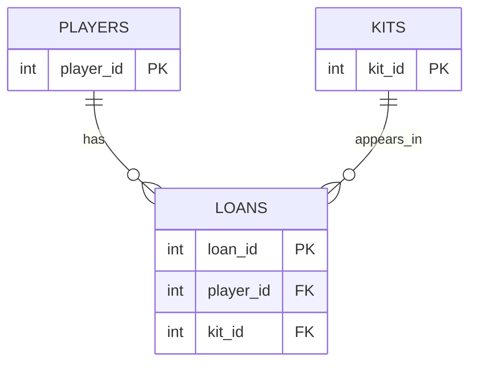

A loan record connects a player with a kit. Primary keys identify records, while foreign keys maintain relationships between the tables.

## 5. API Reference

**Local base URL:** `http://localhost:3000`

### 5.1 Players APIs

| Method | Endpoint | Purpose |
|---|---|---|
| `POST` | `/players` | Create a player |
| `GET` | `/players` | Retrieve all players |
| `GET` | `/players/:id` | Retrieve a player by ID |
| `PUT` | `/players/:id` | Update a player |
| `DELETE` | `/players/:id` | Delete a player |
| `GET` | `/players/search?q=term` | Search players by name or email |

Example player request:

```json
{
  "player_name": "Sai Charan",
  "email": "sai@example.com",
  "phone": "9876543210"
}
```

### 5.2 Kits APIs

| Method | Endpoint | Purpose |
|---|---|---|
| `POST` | `/kits` | Create a kit |
| `GET` | `/kits` | Retrieve all kits |
| `GET` | `/kits/:id` | Retrieve a kit by ID |
| `PUT` | `/kits/:id` | Update a kit |
| `DELETE` | `/kits/:id` | Delete a kit |
| `GET` | `/kits/search?q=term` | Search kits by kit name or sport |

Example kit request:

```json
{
  "kit_name": "Cricket Bat",
  "sport": "Cricket",
  "quantity": 10
}
```

When a kit is created, its available quantity is initialized from its total quantity. The kit update logic adjusts available quantity when the total quantity changes while accounting for equipment that has already been issued.

### 5.3 Loans APIs

| Method | Endpoint | Purpose |
|---|---|---|
| `GET` | `/loans` | Retrieve all loan records |
| `GET` | `/loans/joined` | Retrieve loan records with player and kit details using SQL JOIN |
| `POST` | `/loans` | Create a loan |
| `GET` | `/loans/check-availability/:kit_id` | Check kit availability |

Example loan request:

```json
{
  "player_id": 1,
  "kit_id": 1,
  "issue_date": "2026-11-15"
}
```

### 5.4 Loan return APIs

The supplied Hitesh contribution report describes the following return operations:

| Method | Endpoint | Purpose |
|---|---|---|
| `PUT` | `/loans/:id/return` | Return a loan by loan ID |
| `PATCH` | `/loans/:id/return` | Return a loan by loan ID |
| `POST` | `/loans/:id/return` | Return a loan by loan ID |
| `POST` | `/loans/return` | Return using a loan ID or kit ID |

Refer to the current `routes/loans.js` implementation for the exact supported methods, request body, and response format in the repository.

## 6. Input Validation, Search and Loan Rules

### 6.1 Input validation

The validation middleware described in Jeevan's report checks the following:

**Players**
- Player name must not be empty.
- Email must follow a valid email format.
- Phone number must contain exactly 10 digits.

**Kits**
- Kit name must not be empty.
- Sport name must not be empty.
- Quantity must be a non-negative integer.

**Loans**
- Player ID must be valid.
- Kit ID must be valid.
- Issue date must use the `YYYY-MM-DD` format.
- Return date must use the `YYYY-MM-DD` format when provided.

The existing loan business rules separately handle player and kit existence, kit availability, and loan processing.

### 6.2 Search functionality

**Player search:** `GET /players/search?q=searchterm`
- Searches `player_name` and `email`.
- Supports partial and case-insensitive matching.
- Can return multiple matching records.
- Returns an empty array when there are no matches.
- Returns HTTP `400` when the search query is empty.

**Kit search:** `GET /kits/search?q=searchterm`
- Searches `kit_name` and `sport`.
- Supports partial and case-insensitive matching.
- Can return multiple matching records.
- Returns an empty array when there are no matches.
- Returns HTTP `400` when the search query is empty.

### 6.3 Loan availability and returns

According to Hitesh's report, loan creation checks whether the kit is already on loan and whether stock is available. A conflicting request is rejected with HTTP `409 Conflict` to prevent double booking.

When equipment is returned, the loan status is updated to `RETURNED`, the return date is recorded, and available kit quantity is restored. Duplicate returns are rejected.

### 6.4 Transactions and concurrency protection

Hitesh's report describes transaction handling through `withTransaction()` in `services/loanRules.js`. Loan creation and return operations use SQLite transactions with commit on success and rollback on failure.

The report also describes an in-memory serialization queue for the shared SQLite connection and a partial unique index in `database/schema.sql`:

```sql
CREATE UNIQUE INDEX IF NOT EXISTS idx_unique_active_kit_loan
    ON loans(kit_id)
    WHERE status = 'ACTIVE';
```

This index is intended to prevent more than one active loan for the same kit.

## 7. Individual Team Contributions

### 7.1 S. Dheeraj Kumar – Backend Setup and Database Initialization

**Role:** Backend setup, Express server, project structure, route mounting, and database setup.

Dheeraj established the backend foundation of SportsShed. His reported work includes:

- Initializing the Node.js project and installing dependencies such as Express, SQLite3, and Nodemon.
- Configuring the main Express application in `app.js`.
- Setting up the server port and JSON middleware.
- Creating root and health-check endpoints.
- Mounting the Players, Kits, and Loans route modules.
- Creating the SQLite connection and database initialization process.
- Enabling foreign-key support and executing the database schema.
- Organizing the project into database, middleware, routes, and services folders.
- Starting the server after database initialization and checking the server and routes.

**Main files:** `app.js`, `database/db.js`, `database/schema.sql`, `package.json`, and related project configuration files.

**Postman and setup screenshots**

**Project structure**

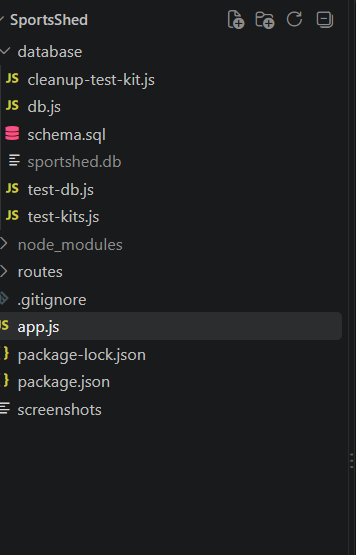

**Express server configuration**

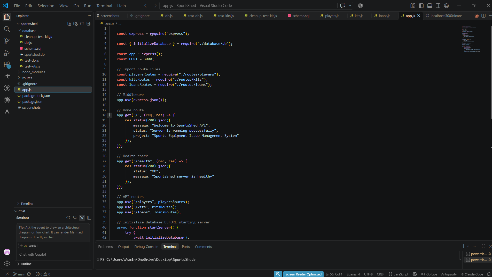

**Database connection**

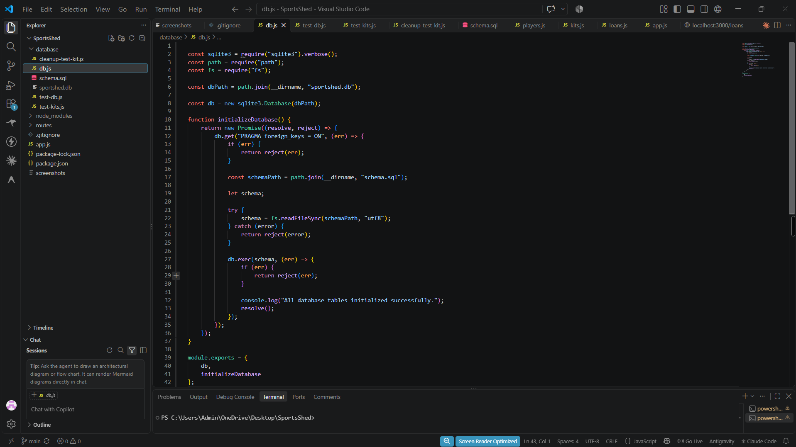

**Database schema**


**Server running**

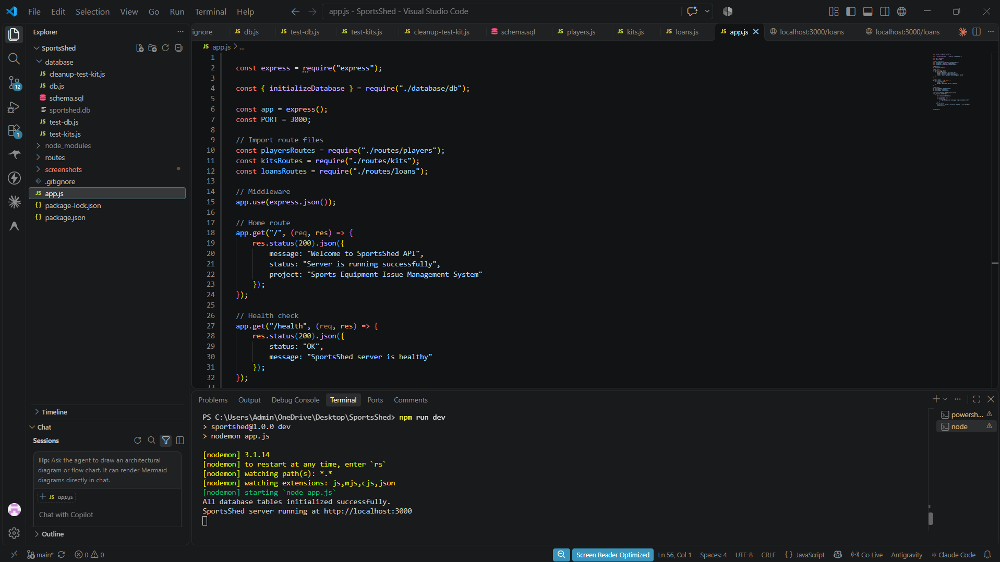

**Root endpoint**

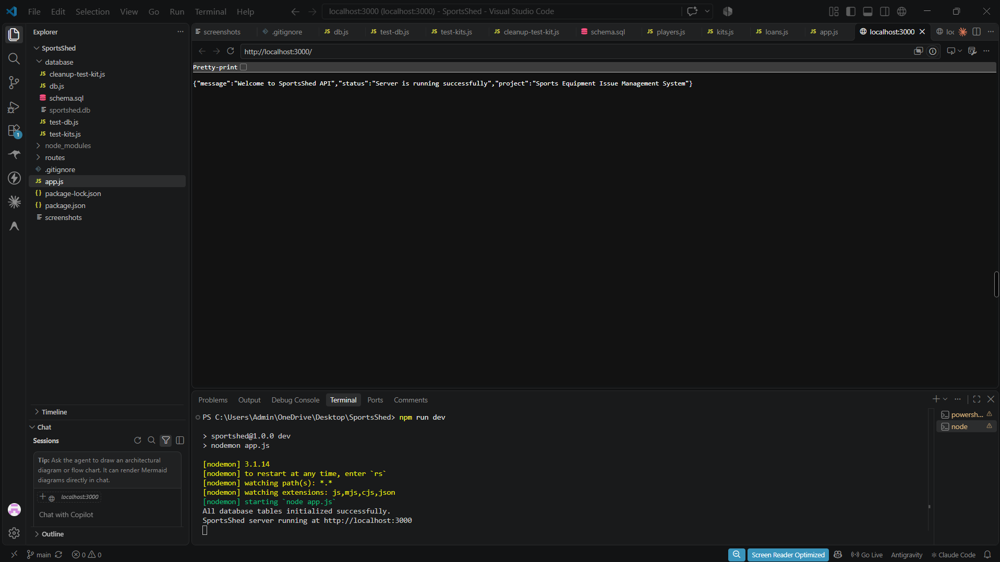

**Health endpoint**


**Players route**


**Kits route**


**Loans route**


**GitHub repository**

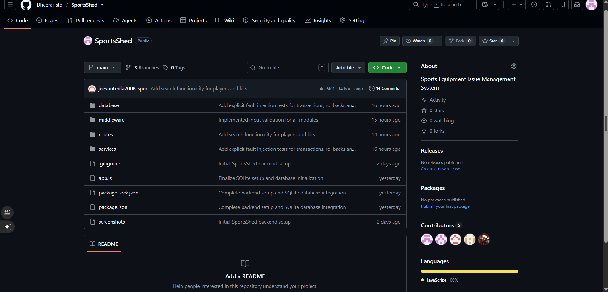

**GitHub pull requests**

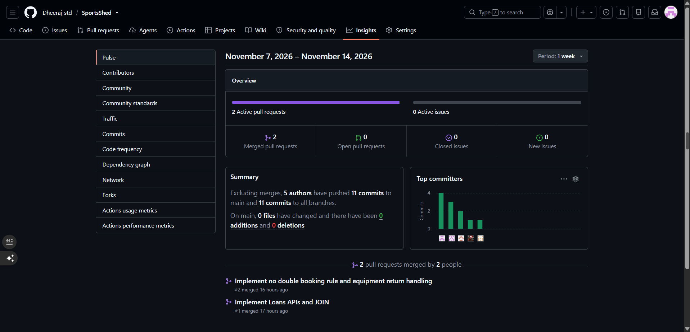

### 7.2 Sai Charan – Players and Kits CRUD APIs

**Role:** Development of Players and Kits CRUD operations.

Sai Charan implemented the Players and Kits CRUD API routes using Node.js, Express.js, and SQLite.

**Players endpoints**
- `POST /players` – creates a player record.
- `GET /players` – retrieves all player records.
- `GET /players/:id` – retrieves a player using the player ID.
- `PUT /players/:id` – updates player information.
- `DELETE /players/:id` – deletes a player record.

**Kits endpoints**
- `POST /kits` – creates a kit record.
- `GET /kits` – retrieves all kit records.
- `GET /kits/:id` – retrieves a kit using the kit ID.
- `PUT /kits/:id` – updates kit information.
- `DELETE /kits/:id` – deletes a kit record.

**Implementation details**
- Used parameterized SQL queries for database operations.
- Added handling for records that do not exist and database errors.
- Duplicate player email addresses are rejected by the database uniqueness constraint.
- Foreign-key relationships prevent deletion of player or kit records that are referenced by loan records.
- Kit creation initializes available quantity from total quantity.
- Kit quantity updates adjust available quantity while accounting for equipment already issued.

**Testing:** Sai reported testing all ten Players and Kits CRUD endpoints using Postman. The supplied screenshots show successful player and kit creation and selected error responses.

**GitHub contribution**
- GitHub username: `saicharanx`
- Branch: `main`
- Commit: `0d62bcd`
- Commit message: `Ive added CRUD operations for Players and Kits`

**Main files:** `routes/players.js` and `routes/kits.js`.

**Postman screenshots**

**Player creation success**

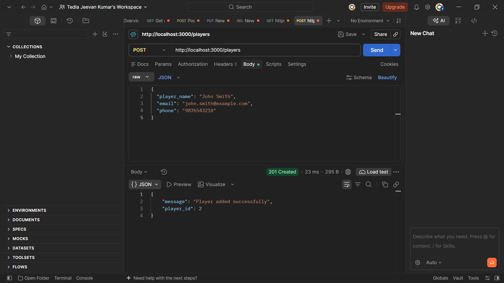

**Player validation response**

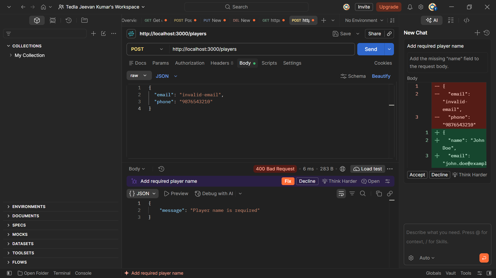

**Kit creation success**

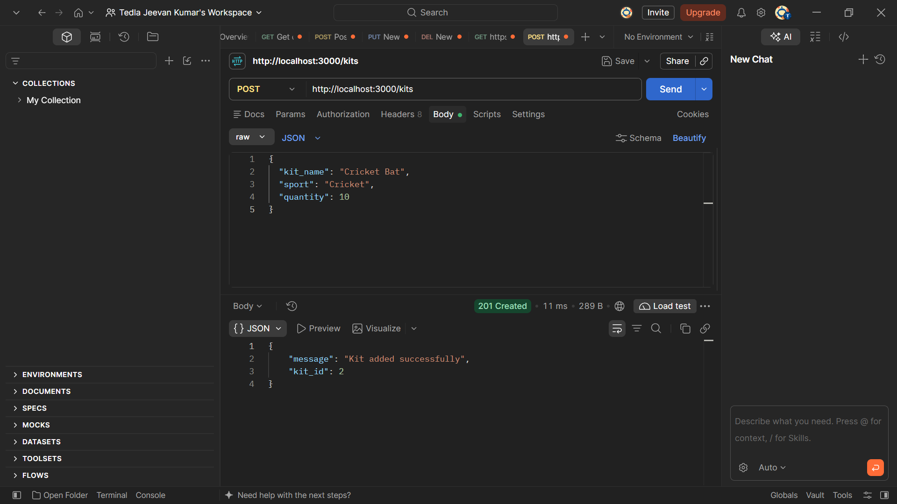

**Kit validation response**

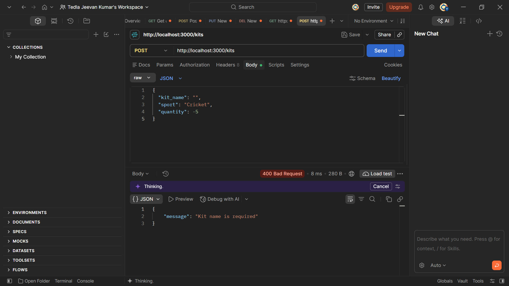

### 7.3 Venkatesh – Loans APIs and SQL JOIN

**Role:** Loans API endpoints and SQL JOIN implementation.

Venkatesh's supplied contribution report identifies the following work in `routes/loans.js`:

- `GET /loans` – retrieves all loan records and returns them as JSON.
- `GET /loans/joined` – uses SQL JOIN to combine loan records with the Players and Kits tables and return player names and kit names with loan details.
- `POST /loans` – creates a loan using player ID, kit ID, and issue date, returning HTTP `201 Created` when successful.

**Technologies used:** Node.js, Express.js, SQLite, JavaScript, Postman, Git, and GitHub.

**Testing reported:** The three endpoints were tested using Postman. The reported responses were HTTP `201` for `POST /loans` and HTTP `200` for both GET endpoints.

**GitHub contribution**
- Branch: `feature/loans-apis`
- Commit: `2979fba`
- Pull request: [PR #1 – Implement Loans APIs and JOIN](https://github.com/Dheeraj-std/SportsShed/pull/1)

**Main file:** `routes/loans.js`.

**Postman screenshots**

**Loan creation success**

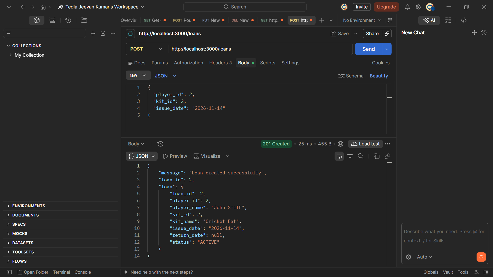

**Loan validation response**

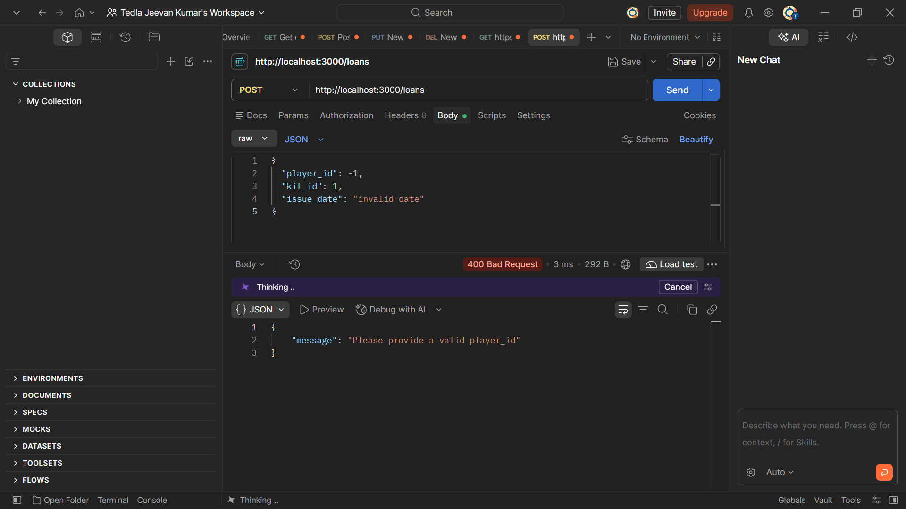

### 7.4 Hitesh Sai – Loan Business Rules, Returns and Transactions

**Role:** Business rules, prevention of double booking, equipment returns, transaction handling, and concurrency protection.

According to Hitesh's individual contribution report, he implemented the loan business rules to prevent the same kit from being issued to two players simultaneously. He also implemented the equipment return flow and transaction handling for loan issue and return operations.

**Double-booking prevention**
- Checks whether a kit already has an active loan.
- Checks whether stock is available before issuing a kit.
- Rejects a conflicting issue request with HTTP `409 Conflict`.
- The reported conflict message is `Kit is currently on loan and cannot be double booked`.

**Equipment returns**
- Updates loan status to `RETURNED`.
- Records the return date.
- Restores available kit quantity, capped at total quantity.
- Rejects duplicate returns.

**Transactions**
- Created `withTransaction()` in `services/loanRules.js`.
- Uses `BEGIN IMMEDIATE TRANSACTION`, `COMMIT`, and `ROLLBACK`.
- Keeps related loan and stock updates consistent if an operation fails.

**Concurrency and database constraint**
- Reported an in-memory serialization queue for the shared SQLite connection.
- Added a partial unique index to prevent multiple active loans for the same kit.

**Files created or modified**

| File | Reported work |
|---|---|
| `services/loanRules.js` | Transaction handling, kit availability checks, validated loan creation, and return operations |
| `routes/loans.js` | Integrated loan rules and added or updated loan and return endpoints |
| `database/schema.sql` | Added partial unique index for active kit loans |
| `database/test-loan-rules.js` | Automated tests for loan rules, rollback behavior, and concurrency scenarios |

**Test scenario described in Hitesh's report**

| Step | Action | Reported result |
|---|---|---|
| 1 | Player 1 requests Kit 101 | HTTP `201`; available stock changes from 1 to 0 |
| 2 | Player 2 requests Kit 101 while it is on loan | HTTP `409`; second loan is blocked |
| 3 | Player 1 returns Kit 101 | HTTP `200`; stock is restored to 1 |
| 4 | Player 2 requests Kit 101 again | HTTP `201`; kit can be issued again |

The report also describes fault-injection rollback testing and a concurrency test where three simultaneous requests competed for one kit. According to the report, one request succeeded and two were rejected.

**GitHub contribution**
- Branch: `feature/loan-rules-testing`
- Pull request: [PR #2 – SportsShed](https://github.com/Dheeraj-std/SportsShed/pull/2)
- Commits reported:
  - `79eb3ca` – Implement no double booking rule and equipment return handling
  - `a241490` – Make loan creation and equipment return atomic with SQLite transactions and concurrency safety
  - `1dd35c8` – Merge branch `origin/main` into `feature/loan-rules-testing`
  - `73bbd11` – Add explicit fault injection tests for transactions, rollbacks and state checks

**Screenshot evidence:** The supplied Postman set includes a successful loan-return response. It does not include separate screenshots of the double-booking conflict, transaction rollback, or concurrency test output. The test details above are therefore attributed to Hitesh's written contribution report.

**Postman screenshot**

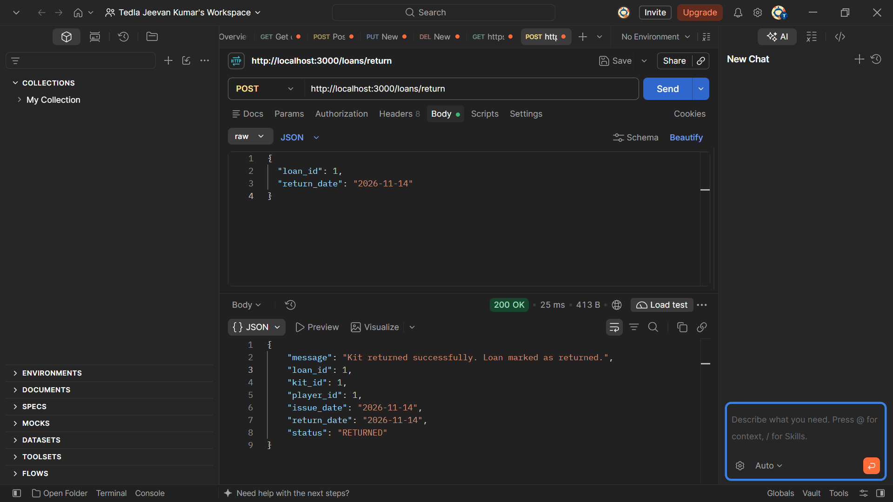

### 7.5 Jeevan – Input Validation and Search Functionality

**Role:** Backend input validation, Player and Kit search functionality, and Postman API testing.

Jeevan's contribution focused on improving data accuracy, preventing invalid input, making records easier to find, and testing API behavior.

**Files created and modified**

| File | Contribution |
|---|---|
| `middleware/validation.js` | Created validation middleware for Players, Kits, and Loans |
| `routes/players.js` | Integrated player validation and implemented Player search |
| `routes/kits.js` | Integrated kit validation and implemented Kit search |
| `routes/loans.js` | Integrated loan and return-date validation |

**Player validation**
- Player name must not be empty.
- Email must follow a valid email format.
- Phone number must contain exactly 10 digits.

**Kit validation**
- Kit name must not be empty.
- Sport name must not be empty.
- Quantity must be a non-negative integer.

**Loan validation**
- Player ID must be valid.
- Kit ID must be valid.
- Issue date must follow `YYYY-MM-DD`.
- Return date must follow `YYYY-MM-DD` when provided.

The existing loan business rules handle player and kit existence checks, kit availability, and loan processing.

**Player search endpoint:** `GET /players/search?q=searchterm`

Search fields:
- `player_name`
- `email`

Features:
- Supports partial matching.
- Supports case-insensitive searching.
- Returns multiple matching player records.
- Returns an empty array when no records match.
- Returns HTTP `400` when the search query is empty.

**Kit search endpoint:** `GET /kits/search?q=searchterm`

Search fields:
- `kit_name`
- `sport`

Features:
- Supports partial matching.
- Supports case-insensitive searching.
- Returns multiple matching kit records.
- Returns an empty array when no records match.
- Returns HTTP `400` when the search query is empty.

**Postman testing reported**
- Successful player creation.
- Missing player name and invalid email.
- Invalid email and invalid phone number.
- Successful kit creation.
- Empty kit name and negative quantity.
- Empty sport name.
- Successful loan creation.
- Invalid issue date.
- Non-existent player ID and kit ID.
- Invalid return date.
- Player search by full or partial name.
- Case-insensitive player search.
- Player search with no matches.
- Kit search by partial name and sport.
- Empty search query returning HTTP `400`.

**GitHub contribution:** The supplied report identifies the commit message as `Add search functionality for players and kits`. A branch name, commit hash, and pull request number were not included in the supplied details.

**Postman screenshots**

The seven supplied search screenshots are embedded below.

**Player search by name**

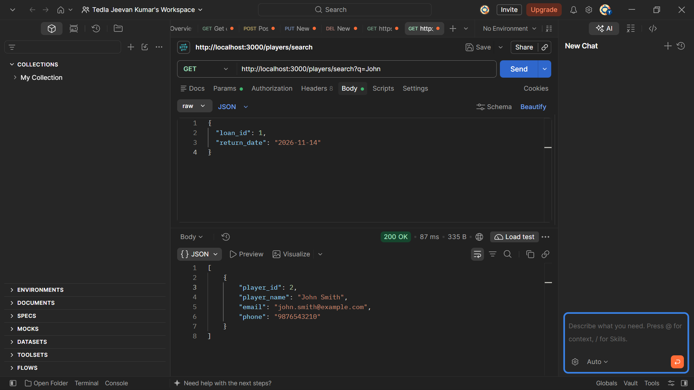

**Player search by email**


**Case-insensitive player search**

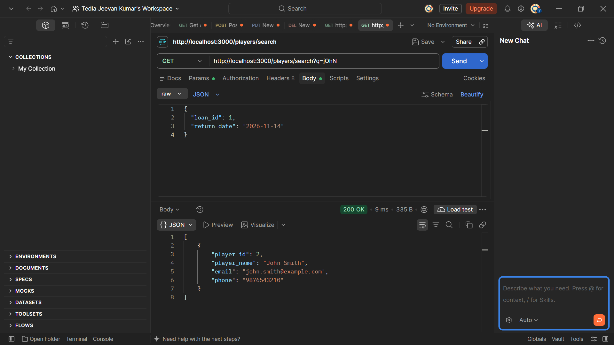

**Player search with no results**

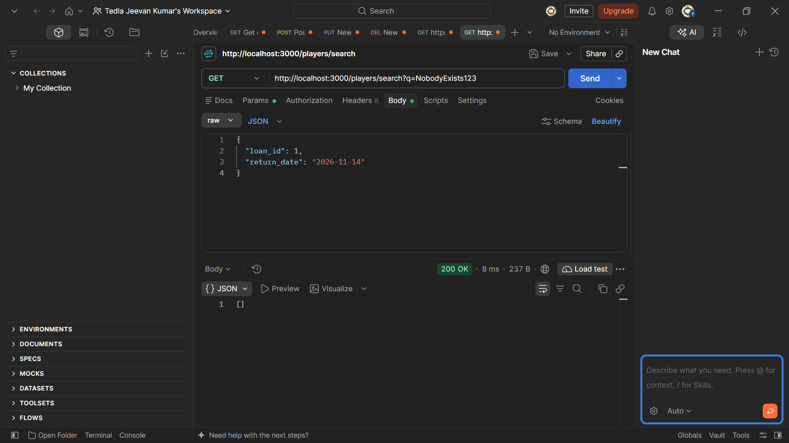

**Kit search by name**

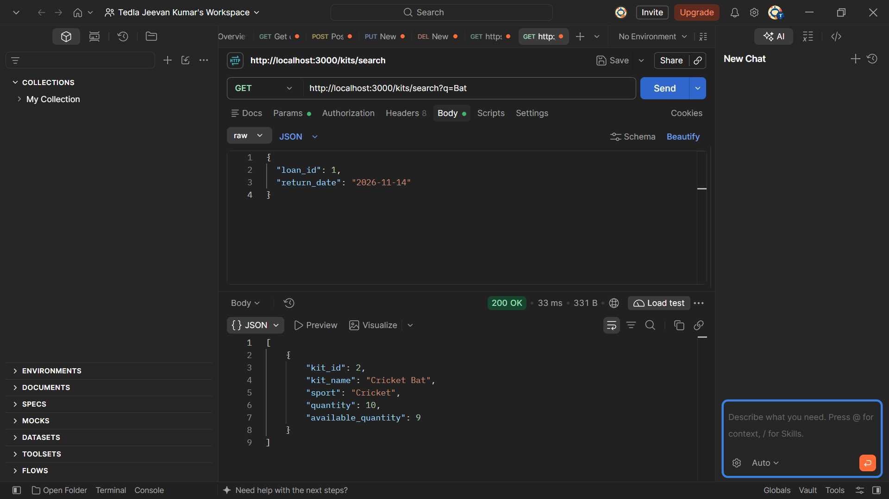

**Kit search by sport**

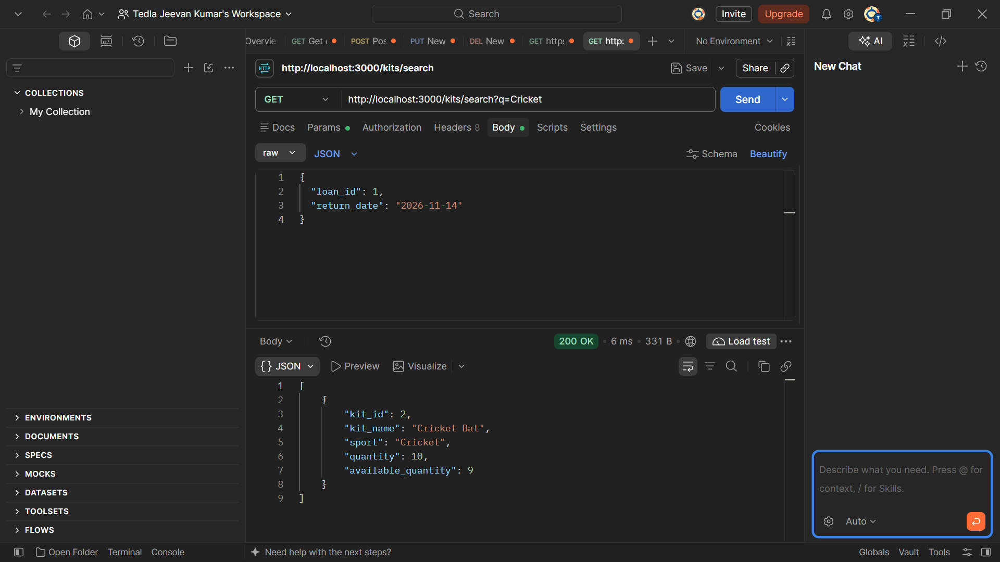

**Empty search query error**

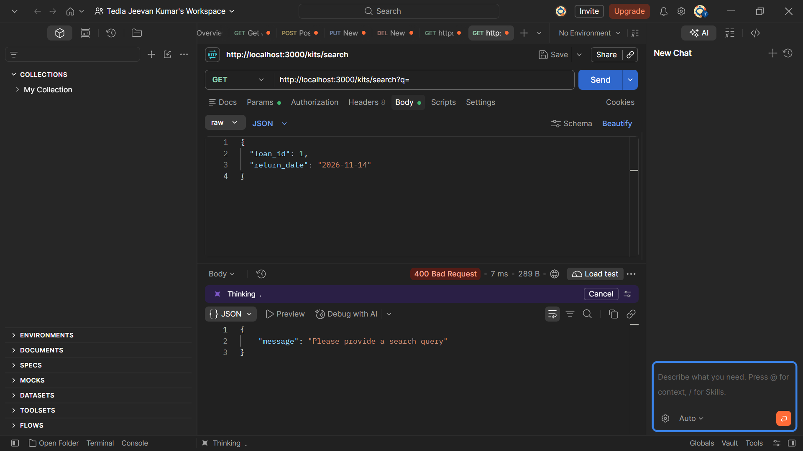

The player, kit, and loan validation screenshots are shown under the related API sections above. Those groupings indicate the functionality demonstrated by each screenshot, not independent proof of code authorship.

---

## 8. Postman Testing Evidence

All 14 Postman screenshots supplied for this documentation are included in this repository package and embedded in the relevant contribution sections above.

```text
screenshots/
├── sai-charan/
│   ├── 01-player-success.png
│   ├── 02-player-validation-error.png
│   ├── 03-kit-success.png
│   └── 04-kit-validation-error.png
├── venkatesh/
│   ├── 05-loan-success.png
│   └── 06-loan-validation-error.png
├── hitesh/
│   └── 07-loan-return-success.png
└── jeevan/
    ├── player-search-by-name.png
    ├── player-search-by-email.png
    ├── player-search-case-insensitive.png
    ├── player-search-no-results.png
    ├── kit-search-by-name.png
    ├── kit-search-by-sport.png
    └── search-empty-query-error.png
```

**Evidence limitations:** The supplied screenshot set does not contain the 12 Dheeraj setup/repository images mentioned in his original report. It also does not contain separate screenshots of Hitesh's double-booking conflict, transaction rollback, or concurrency tests. Those details are included only as reported in the respective written contribution reports, not presented as screenshot-verified results.

## 9. Installation and Execution

### Requirements

- Node.js
- npm

### Steps

1. Clone the repository:

   ```bash
   git clone https://github.com/Dheeraj-std/SportsShed.git
   ```

2. Open the project folder:

   ```bash
   cd SportsShed
   ```

3. Install dependencies:

   ```bash
   npm install
   ```

4. Start the server using the configured script:

   ```bash
   npm start
   ```

5. For development with automatic restart, if the script is configured:

   ```bash
   npm run dev
   ```

The application is configured to run locally at `http://localhost:3000`. Confirm the available npm scripts in `package.json` if the start command differs in the current repository version.

## 10. Team Collaboration

The project was developed using a shared GitHub repository. Work was divided by backend responsibility, and members contributed through commits, branches, and pull requests. The work areas included backend setup, player and kit CRUD APIs, loan APIs, loan business rules, input validation, search, and API testing.

**GitHub repository:** [Dheeraj-std/SportsShed](https://github.com/Dheeraj-std/SportsShed)

## 11. Conclusion

SportsShed brings together player management, sports kit management, and equipment loan operations in one backend application. The project demonstrates Express routing, REST API development, SQLite database integration, SQL JOIN operations, input validation, search functionality, equipment availability handling, transaction management, and API testing with Postman.

Each team member contributed to a different part of the backend. Together, these contributions form the application's setup, data management, loan processing, validation, search, and equipment return functionality.
