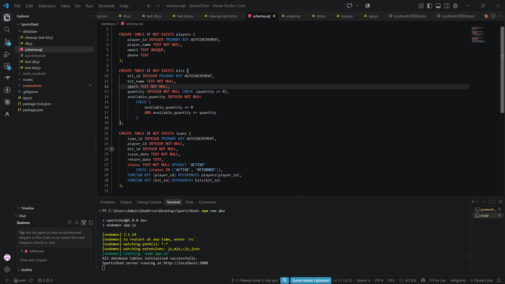
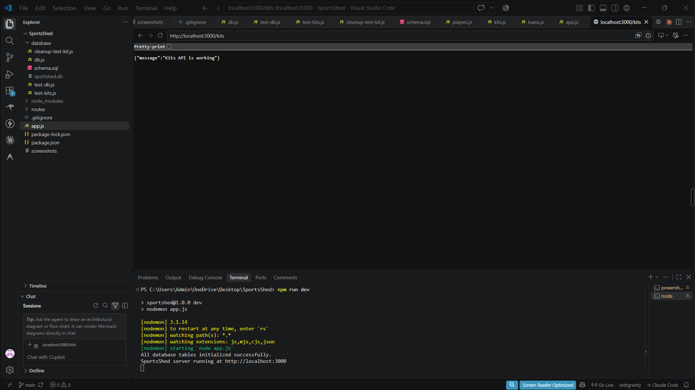

# SportsShed – Individual Contribution

## 1. Student Details

| Particulars | Details |
|---|---|
| Student Name | S. Dheeraj Kumar |
| Project Name | SportsShed – Sports Equipment Issue Management System |
| Group | Group 5 (G05) |
| Individual Role | Backend Setup, Express Server, Project Structure, Route Mounting and Database Setup |
| Technology Stack | Node.js, Express.js, SQLite, JavaScript |
| Academic Year | 2026–2027 |

---

## 2. Introduction

SportsShed is a Sports Equipment Issue Management System developed as a group project.

The main objective of the project is to manage sports equipment, player information and equipment issue and return records.

My individual contribution focuses on establishing the backend foundation of the application. This includes setting up the Node.js environment, configuring the Express server, organizing the project structure, mounting the API routes and establishing the SQLite database connection and initialization.

This document describes my individual work and the implementation evidence.

---

## 3. Tools and Technologies Used

The following tools and technologies were used for my contribution:

- **Node.js:** JavaScript runtime environment.
- **Express.js:** Backend web framework.
- **SQLite:** Database management system.
- **JavaScript:** Backend programming language.
- **Nodemon:** Automatically restarts the server during development.
- **Visual Studio Code:** Development environment.
- **Git:** Version control.
- **GitHub:** Repository hosting and collaboration.

---

## 4. Backend Project Setup

I initialized the Node.js project and installed the required dependencies for backend development.

### Commands Used

Initialize the project:

```bash
npm init -y
```

Install Express:

```bash
npm install express
```

Install SQLite:

```bash
npm install sqlite3
```

Install Nodemon:

```bash
npm install --save-dev nodemon
```

The project was configured to run in development mode using:

```bash
npm run dev
```

This setup provided the required environment for developing and testing the SportsShed backend.

---

## 5. Project Structure

I organized the backend project into separate folders to maintain a modular and structured architecture.

### Project Directory

```text
SportsShed/
│
├── database/
│   ├── db.js
│   ├── schema.sql
│   └── sportshed.db
│
├── middleware/
│
├── routes/
│   ├── players.js
│   ├── kits.js
│   └── loans.js
│
├── services/
│
├── screenshots/
│
├── app.js
├── package.json
├── package-lock.json
└── .gitignore
```

The main folders are organized as follows:

- **database:** Contains the SQLite connection and database schema.
- **middleware:** Contains middleware used by the application.
- **routes:** Contains separate route files for Players, Kits and Loans.
- **services:** Contains supporting service logic.
- **screenshots:** Stores implementation screenshots and evidence.
- **app.js:** Main Express server file.

### Screenshot – Project Structure


---

## 6. Express Server Configuration

I configured the main Express application in `app.js`.

The server configuration includes:

1. Importing the Express framework.
2. Creating the Express application.
3. Setting the server port to 3000.
4. Importing the Players, Kits and Loans route modules.
5. Configuring JSON middleware using `express.json()`.
6. Creating the root endpoint.
7. Creating the health-check endpoint.
8. Mounting the feature routes.
9. Initializing the database before starting the server.

### Route Mounting

The following code connects the individual route modules to the main application:

```javascript
app.use("/players", playersRoutes);
app.use("/kits", kitsRoutes);
app.use("/loans", loansRoutes);
```

This modular approach keeps the application organized and allows each feature to be developed separately.

### Screenshot – Express Server Configuration


---

## 7. SQLite Database Setup

I established the SQLite database connection and initialization process.

The database configuration is implemented in:

`database/db.js`

The database setup includes:

- Importing the SQLite3 package.
- Creating or opening the `sportshed.db` database.
- Enabling foreign-key support.
- Reading the SQL commands from `schema.sql`.
- Executing the schema to initialize database tables.
- Exporting the database connection and initialization function.

### Database Initialization

The database initialization function ensures that the database schema is executed before the Express server starts.

The application imports the initialization function using:

```javascript
const { initializeDatabase } = require("./database/db");
```

### Database Schema

The project contains three main tables:

| Table | Purpose |
|---|---|
| players | Stores player information |
| kits | Stores sports equipment information and quantity details |
| loans | Stores equipment issue and return records |

The schema includes primary keys, foreign-key relationships and data constraints.

### Screenshot – Database Connection


### Screenshot – Database Schema



---

## 8. Server Execution and Testing

I executed the backend server in development mode using Nodemon.

### Command

```bash
npm run dev
```

The server successfully initialized the database and started running on:

```text
http://localhost:3000
```

### Local Endpoint Verification

The following URLs were used to verify the server and mounted routes:

| Endpoint | Purpose |
|---|---|
| http://localhost:3000/ | Root welcome response |
| http://localhost:3000/health | Server health check |
| http://localhost:3000/players | Players route |
| http://localhost:3000/kits | Kits route |
| http://localhost:3000/loans | Loans route |

The root endpoint returned the SportsShed welcome response, while the health endpoint confirmed that the server was running.

The Players, Kits and Loans endpoints were also checked for route accessibility.

These initial checks demonstrate server execution and route mounting. They should not be considered proof of every CRUD operation or business rule implemented by the team.

### Screenshot – Server Running


### Screenshot – Root Endpoint


### Screenshot – Health Endpoint


### Screenshot – Players Route


### Screenshot – Kits Route



### Screenshot – Loans Route


---

## 9. Git and GitHub Contribution

I used Git and GitHub to maintain the backend project and share implementation changes with the group.

My GitHub-related activities included:

- Initializing Git in the project directory.
- Creating and maintaining the main branch.
- Committing backend setup changes.
- Pushing project files to the shared GitHub repository.
- Adding implementation screenshots to the repository.
- Synchronizing local changes with the remote repository.
- Pushing the updated README and project documentation.

### Git Commands Used

Initialize Git:

```bash
git init
```

Add project files:

```bash
git add .
```

Commit changes:

```bash
git commit -m "Complete backend setup and database initialization"
```

Synchronize with the remote repository:

```bash
git pull --rebase origin main
```

Push changes:

```bash
git push origin main
```

### GitHub Repository

Repository Link:

https://github.com/Dheeraj-std/SportsShed

### Screenshot – GitHub Repository


### Screenshot – GitHub Pull Request Activity


---

## 10. Individual Contribution Summary

The following table summarizes my individual responsibilities and completed groundwork.

| S. No. | Task | Contribution |
|---|---|---|
| 1 | Backend Setup | Initialized the Node.js project and installed dependencies |
| 2 | Express Server | Configured the main Express application |
| 3 | Project Structure | Organized the backend folders and files |
| 4 | Route Mounting | Connected Players, Kits and Loans route modules |
| 5 | Database Setup | Established SQLite connection and schema initialization |
| 6 | Server Verification | Started the server and checked local endpoints |
| 7 | Version Control | Used Git and GitHub to commit and share changes |
| 8 | Documentation | Prepared implementation documentation and screenshots |

---

## 11. Conclusion

My individual contribution established the backend foundation of the SportsShed project.

I configured the Node.js and Express environment, organized the project structure, mounted the Players, Kits and Loans route modules, and established SQLite database connectivity and initialization.

I also verified the server locally and maintained the project using Git and GitHub.

This backend groundwork provided the foundation for the team to develop, test and integrate the remaining features of the SportsShed Sports Equipment Issue Management System.

---

## 12. Repository Information

**Project:** SportsShed – Sports Equipment Issue Management System

**GitHub Repository:**  
https://github.com/Dheeraj-std/SportsShed

**Individual Contribution:**  
Backend Setup, Express Server Configuration, Project Structure, Route Mounting and SQLite Database Setup.
